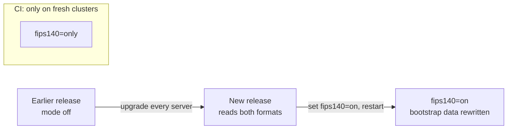

# Run under Go's FIPS 140-3 mode

Date: 2026-11-14

## Status

Proposed

## Context

Some sites may only run software whose cryptography comes from a FIPS 140-3 validated module. They are often regulated and airgapped, and many are at the edge, on one node or a few. RKE2 serves them today through BoringCrypto. K3s's single binary and small footprint suit those sites. Go now ships its own FIPS 140-3 module: `GODEBUG=fips140=on` turns the mode on at run time, and a build with `GOFIPS140=v1.0.0` links the version that holds the validation certificate. This ADR proposes that K3s run in that mode, from one server to many, so those operators have the option ([#14984](https://github.com/k3s-io/k3s/issues/14984)).

Today it does not. On `main`, runc fails the module's integrity check, so no pod starts. With that fixed, `on` runs, but K3s still derives bootstrap keys with PBKDF2-SHA-1 and hashes node passwords with an 8-byte salt, and Go's stricter `only` mode stops on both. The desired state is K3s running under `on` in every supported configuration, on new and upgraded clusters, with `only`, which Go calls "a best effort mode meant for testing, assessment, and debugging" ([Go](https://go.dev/doc/security/fips140)), running in CI to catch the next non-approved call.

### Security Considerations

Some SHA-1 is fixed by a protocol or by values peers already hold: the websocket handshake (RFC 6455), etcd's member and cluster IDs, wrangler's object set hash and dynamiclistener's certificate fingerprint. Changing them would change values that peers and stored objects already hold, so they stay SHA-1. Go's [`fips140.WithoutEnforcement`](https://pkg.go.dev/crypto/fips140#WithoutEnforcement) lets such a call run under `only`, and Go says it "should be applied carefully to tightly scoped functions". A wrap covers every goroutine started inside it, and the K3s wraps are wide: `only` does not test embedded etcd, tunnel sessions or `kubectl`. K3s's own code, the apiserver and the kubelet stay enforced.

### Supported Configurations

Under `on`, every datastore works (PostgreSQL, MySQL, MariaDB, SQLite, embedded and external etcd), as does `wireguard-native`. The `only` job does not cover MariaDB (SHA-1 in legacy auth), `wireguard-native` (X25519), PostgreSQL `md5`, MySQL `mysql_native_password`, or the `secretbox` provider, which `only` does not detect. Snapshot restore works under `only`, and `kubectl exec` works under `only` over SPDY fallback. An external NATS server, `host-gw` and agentless servers work under `on` and `only`; the published binary does not include embedded NATS. Not run: tailscale. On release branches a token shorter than 14 bytes is refused at `token rotate` under `only`.

### Upgrade Workflow

Upgrade every server with the mode off, then set `on`. The bootstrap data rewrite waits until every control-plane node carries the annotation `k3s.io/bootstrap-sha256` and retries each minute, as `secrets-encrypt` checks each node before a one-way step. A cluster that mixes releases stays on the legacy format. The FIPS build is under `on` from its first start, so an existing cluster upgrades on the standard binary first, then moves to the FIPS build of the same release. Once `on` has rewritten the bootstrap data, an earlier release cannot read it, so a downgrade needs a backup taken before.

### Existing Work

- runc integrity check: [#14980](https://github.com/k3s-io/k3s/pull/14980)
- bootstrap data on PBKDF2-SHA-256 with a 16-byte salt, and the migration: [#14981](https://github.com/k3s-io/k3s/pull/14981)
- node password salt of 16 bytes, with an error and remedy under `only`: [#14985](https://github.com/k3s-io/k3s/pull/14985)
- ipset name on SHA-256: [k3s-io/kube-router#90](https://github.com/k3s-io/kube-router/pull/90)
- protocol SHA-1 wrapped in the libraries: [wrangler#797](https://github.com/rancher/wrangler/pull/797), [dynamiclistener#390](https://github.com/rancher/dynamiclistener/pull/390)
- etcd: narrow wraps at its two SHA-1 ID calls, to be offered on etcd `main` ([etcd-io/etcd#21673](https://github.com/etcd-io/etcd/issues/21673)). etcd has not agreed to take them; K3s wraps `embed.StartEtcd` until its pin carries them.
- K3s call-site wraps for the tunnel server, the agent dial, `kubectl` and snapshot restore: a PR after this ADR is accepted.
- the FIPS build: K3s's build does not pass `GOFIPS140` through today. [#14999](https://github.com/k3s-io/k3s/pull/14999) passes it through; the release change follows once this ADR is accepted.

The series applies to `main`, release-1.36 and release-1.37, where it was tested; release-1.34 and 1.35 were not tested, and 1.33 cannot take it. With it applied to main and to release-1.36, unit tests pass under off, `on` and `only`, and three docker suites pass on both: `Test_DockerFIPS` (7 of 7), `Test_DockerFIPSMigration` (8 of 8) and `Test_DockerFIPSMixedVersion` (8 of 8). Stock fails `Test_DockerFIPS` under `only` at cluster setup. On `main`, with the series and [#14999](https://github.com/k3s-io/k3s/pull/14999), a FIPS build from `make` started with `GODEBUG` unset runs a pod that answers `kubectl exec` and a ClusterIP service. Logs: https://github.com/andrewdunndev/k3s-fips140-evidence/tree/adr-1.

[#1502](https://github.com/k3s-io/k3s/issues/1502) asked for a certified K3s; this ADR does not offer certification. brandond wrote of RKE2, "Eventually we will probably switch to the native module" ([rke2#9453](https://github.com/rancher/rke2/discussions/9453)).

## Decision

K3s will support running under `GODEBUG=fips140=on`, set by the operator, on new and existing clusters, in every supported configuration. `only` is for CI and is not a supported operating mode.

1. K3s's own cryptography uses approved algorithms by default. Options that select a non-approved algorithm stay available and are the operator's choice. Stored values move to approved forms, and `off` and `on` keep reading the old ones. Where `only` cannot read an old value, K3s returns an error that names the remedy instead of rehashing.
2. SHA-1 fixed by a protocol or a stored value stays SHA-1, inside `fips140.WithoutEnforcement`, at the narrowest call the code allows. Narrow wraps belong upstream. The K3s wrap around embedded etcd is a stopgap, dropped once etcd's fix is pinned; the tunnel, `kubectl` and snapshot restore wraps stay.
3. CI runs `fips140=only` on fresh clusters, as a non-required job that detects new non-approved calls.
4. K3s publishes a FIPS build: with each release, a second binary built against the Go module version that holds a validation certificate (`GOFIPS140=v1.0.0` today), which runs under `fips140=on` by default. Images and the install script are left to a later change. The standard binary is unchanged; under `on` it runs the module of its Go release, which is not the validated version. Neither claims compliance: validation belongs to the module, and compliance stays the operator's claim.

## Consequences

- Each `WithoutEnforcement` call is a place SHA-1 runs in FIPS mode.
- A Kubernetes, containerd or flannel bump can add a non-approved call and turn the `only` job red. The job is non-required, and the author will watch it for red and fix what breaks it.
- Each release builds, tests and publishes one more binary per architecture.
- This ADR does not change RKE2, which builds with BoringCrypto today. The library fixes (wrangler, dynamiclistener, kube-router, etcd) are ones RKE2 shares.
