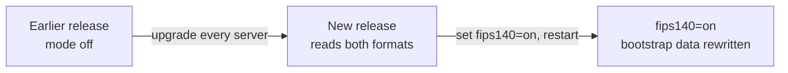

# Run under Go's FIPS 140-3 mode

Date: 2026-11-14

## Status

Proposed

## Context

Some users may be subject to regulations that require them to run software whose cryptographic primitives are provided by a FIPS 140-3 validated module. Clusters operated under these restrictions may be airgapped, at the edge, or comprised of a small number of nodes - all cases where K3s would otherwise be an excellent fit.

Go now ships its own [FIPS 140-3 module](https://go.dev/doc/security/fips140). Binaries may be built with `GOFIPS140=<version>|latest|inprocess|certified` to select a specific module version and enable FIPS 140-3 mode by default; binaries without this set may export `GODEBUG=fips140=on|only` to enable the internal 140-3 module.

K3s is not currently capable of running in any mode other than `fips140=off`. `runc` fails the module's integrity check, which causes pods to fail to start. With that fixed, `fips140=on` runs, but K3s still derives bootstrap keys with PBKDF2-SHA-1 and hashes node passwords with an 8-byte salt, and Go's stricter `fips140=only` mode causes both to raise errors. The desired state is K3s running under `fips140=on` in every supported configuration, on new and upgraded clusters. `fips140=only` is not meant for production use; Go calls it "a best effort mode meant for testing, assessment, and debugging", so this mode should only be used in dev/CI workflows.

### Security Considerations

Some SHA-1 is fixed by a protocol or by values peers already hold: the websocket handshake (RFC 6455), etcd's member and cluster IDs, wrangler's object set hash and dynamiclistener's certificate fingerprint. Changing them would change values that peers and stored objects already hold, so they stay SHA-1. Go's [`fips140.WithoutEnforcement`](https://pkg.go.dev/crypto/fips140#WithoutEnforcement) lets such a call run under `only`, and Go says it "should be applied carefully to tightly scoped functions". A wrap covers every goroutine started inside it, and the K3s wraps are wide: `only` does not test embedded etcd, tunnel sessions or `kubectl`. K3s's own code, the apiserver and the kubelet stay enforced.

### Supported Configurations

Under `on`, every datastore works (PostgreSQL, MySQL, MariaDB, SQLite, embedded and external etcd), as does `wireguard-native`. The `only` startup test does not cover MariaDB (SHA-1 in legacy auth), `wireguard-native` (X25519), PostgreSQL `md5`, MySQL `mysql_native_password`, or the `secretbox` provider, which `only` does not detect. Snapshot restore works under `only`, and `kubectl exec` works under `only` over SPDY fallback. An external NATS server, `host-gw` and agentless servers work under `on` and `only`; the published binary does not include embedded NATS. Not run: tailscale.

### Upgrade Workflow

Upgrade every server with the mode off, then set `on`. A binary built with `GOFIPS140` defaults to `on`, so on that build the operator sets `GODEBUG=fips140=off` until every server is upgraded. The bootstrap data rewrite waits until every control-plane node carries the annotation `k3s.io/bootstrap-sha256` and retries each minute, as `secrets-encrypt` checks each node before a one-way step. A cluster that mixes releases stays on the legacy format. Once `on` has rewritten the bootstrap data, an earlier release cannot read it, so a downgrade needs a backup taken before.

## Decision

This lands on `main` only and is released from 1.38.

K3s will support running under `GODEBUG=fips140=on`, set by the operator, on new and existing clusters, in every supported configuration. `only` is for CI and is not a supported operating mode.

1. K3s's own cryptography uses approved algorithms by default. Options that select a non-approved algorithm stay available and are the operator's choice. Stored values move to approved forms, and `off` and `on` keep reading the old ones. Where `only` cannot read an old value, K3s returns an error that names the remedy instead of rehashing.
2. SHA-1 fixed by a protocol or a stored value stays SHA-1, inside `fips140.WithoutEnforcement`, at the narrowest call the code allows. Narrow wraps belong upstream. The K3s wrap around embedded etcd is a stopgap, dropped once etcd's fix is pinned; the tunnel, `kubectl` and snapshot restore wraps stay.
3. The integration startup test runs under `GODEBUG=fips140=only`, which detects new non-approved calls. One docker test, `Test_DockerFIPSMigration`, covers the move from off to `on` to `only`. K3s publishes no separate FIPS binary or build process; under `on` the one binary runs the module of its Go release, which is not the validated version, and K3s makes no compliance claim.

## Consequences

- Each `WithoutEnforcement` call is a place SHA-1 runs in FIPS mode.
- A Kubernetes, containerd or flannel bump can add a non-approved call and turn the startup test red under `only` on that bump's PR, and the author will fix what breaks it.
